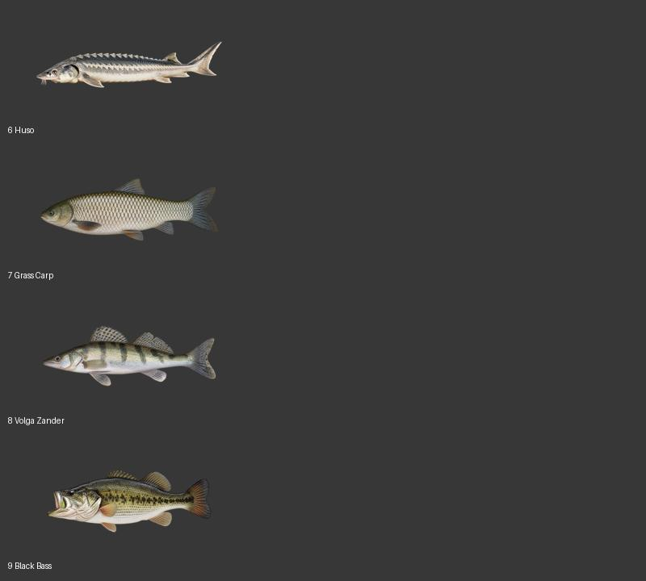

# Ryby ID 6–9 – druhá sada

Hotové nové ikony pro další čtyři ID. Každý ze zdrojových druhů má v `Textures/Fish` pouze nepříponovaný soubor, proto je zde jeden obrázek na druh:

| Soubor | Druh |
| --- | --- |
| `6.png` | Huso |
| `7.png` | Grass Carp |
| `8.png` | Volga Zander |
| `9.png` | Black Bass |

Všechny výstupy jsou PNG 512 × 256 px s průhledným pozadím. Názvy a herní ID odpovídají zdrojům. Soubory `0.png`, `1.png` a `-1.png` zůstávají vynechané.

V modu jsou ikony v `_WorkshopTextures/Textures/Fish/`. Další sada pokračuje od ID `10`.
