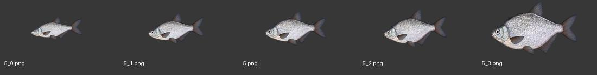

# White-Eye Bream – první sada rybích ikon

## Hotovo
Pět nových průhledných PNG ikon je připraveno v `Textures/Fish/`, přesně 512 × 256 px:
- `5_0.png` – nejmenší varianta
- `5_1.png` – malá varianta
- `5.png` – střední varianta
- `5_2.png` – trofejní varianta
- `5_3.png` – světový rekord

Názvy souborů zachovávají herní ID a přípony. Hmotnostní pořadí bylo ověřeno porovnáním rozsahu ryby v původních obrázcích ve `StreamingAssets/Textures/Fish`. V tomto ID je nejmenší `_0`, pak `_1`, nepříponovaný soubor, `_2` a největší `_3`.

ID `5` je podle `Localization/English/fishLang.txt` White-Eye Bream. Soubory `0.png`, `1.png` a `-1.png` se do sady nezařazují.

## Náhled

## Pokračování
Toto je první dokončená ryba do nové sady. Pokračovat dalším platným ID `6` (Huso), pokud uživatel neurčí jiné pořadí nebo velikost další dávky. U každé ryby zachovat existující přesné názvy, počet variant a rozměr 512 × 256 px. Poslední dvě hmotnostní varianty navrhovat jako jasně trofejní a rekordní, podobně jako zde.
