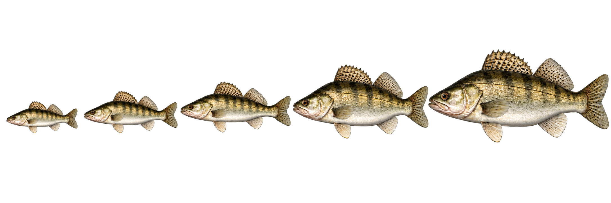

# Koncept ikon candáta podle hmotnosti

## Stav
Uložený pracovní koncept; zatím nejde o hotové ikony hry ani o mod. Příště pokračovat po otevření tohoto souboru a obrázku `zander-weight-concept.png`.

## Zadání uživatele
- Ikony ryb jsou svázané s herním ID a jedna ryba má více obrazových variant odpovídajících její hmotnosti: od malé po největší. Rozdíl v názvu je číselná přípona `_číslo`.
- Začít jedním druhem, zde candátem z ID `105` (`Textures/Fish/105.png`).
- Zachovat stejný druh, realistický vzhled, boční pohled a směr; velikost a mohutnost ryby musí jasně růst s hmotností.
- Poslední dvě varianty mají být na první pohled zvláštní třídy: předposlední trofejní ryba, poslední světový rekord. Rozlišit je hlavně proporcemi a mohutností, bez odznaků či textu.
- Aktuální návrh ukazuje pět variant v řadě: malé, střední, velké, trofejní, světový rekord. Čtvrtý kus je výrazně hlubší a mohutnější; pátý je ještě větší a těžší.

## Co už bylo zjištěno
- `StreamingAssets/Textures/Fish` obsahuje 711 PNG, všechny 512 × 256 px.
- Přípona `_0` až `_3` označuje velikostní variantu podle vysvětlení uživatele. Například `105.png` a `105_0.png` až `105_3.png` patří k candátovi. Před výrobou finálních souborů ještě ověřit přesné pořadí velikostí pro konkrétní ID a jestli nepříponovaná varianta patří do téže škály.
- Anglický lokalizační soubor mapuje ID `105` na `Zander` a vědecký název na `Sander lucioperca`.

## Návrh

Obrázek je koncepční přehled 2172 × 724 px s průhledným pozadím. Není připraven jako herní textura 512 × 256 px: jednotlivé ryby nejsou oříznuté do samostatných souborů a okraje mohou vyžadovat retuš. Nezapisovat jej do herních textur ani nepřepisovat originály.

## Příští postup
1. Zobrazit uživateli uložený návrh a navázat na něj.
2. Pokud návrh vyhovuje, vybrat finální kompozici a rozdělit do samostatných transparentních ikon s přesným rozměrem 512 × 256 px.
3. Přiřadit varianty podle skutečných názvů souborů pro ID `105`; zachovat přesné herní ID a přípony.
4. Porovnat hotové ikony s originálními `Textures/Fish/105*.png` a teprve podle výslovného pokynu uživatele je přidat do modu.
5. Po schválení jednoho druhu pokračovat dalšími druhy.
